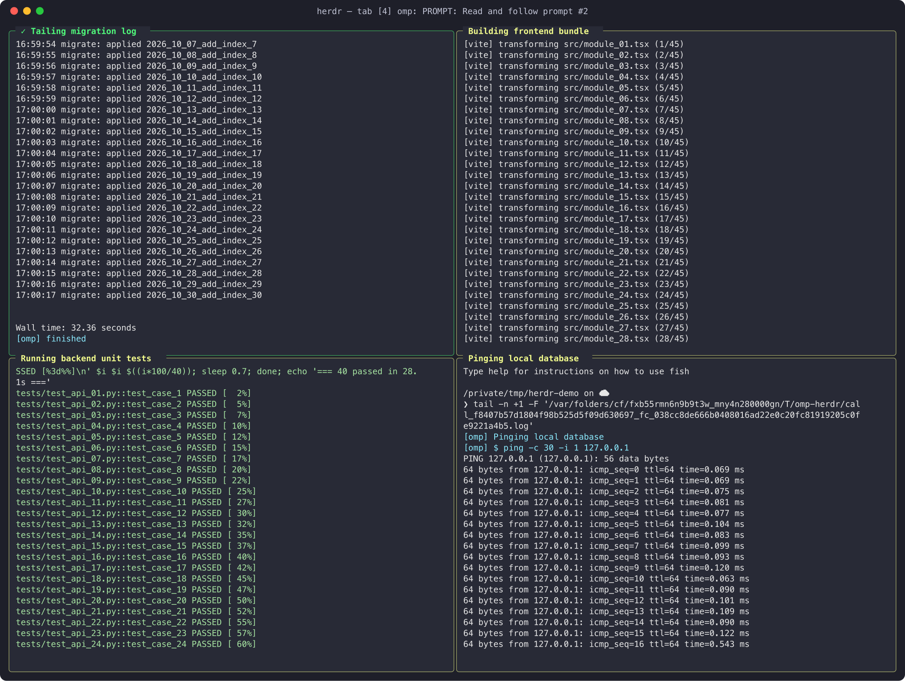
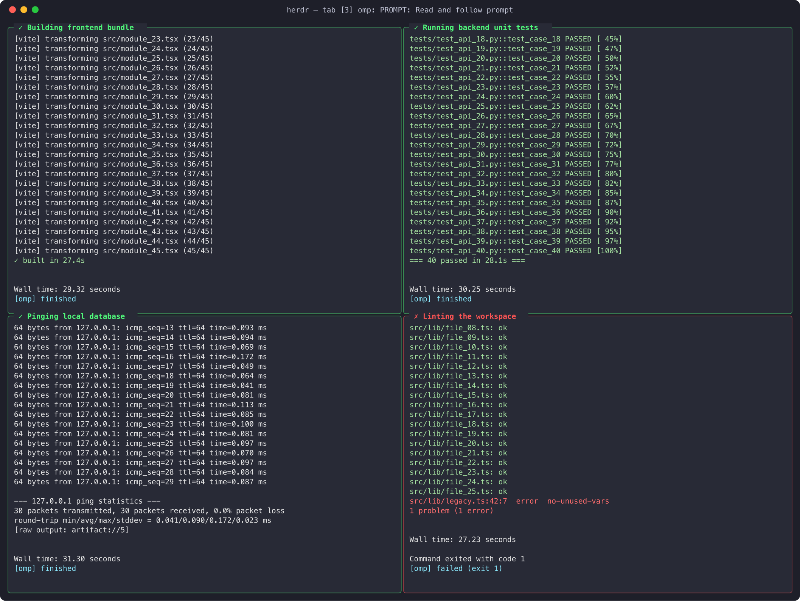

# herdr-bg-tabs

OMP extension that streams the output of long-running OMP `bash` tool calls, line by line, into unfocused Herdr panes. Your current tab stays focused; slow builds, test runs, and servers show up in background tabs you can glance at.

Five parallel bash calls from one agent: a 2×2 jobs tab, with the fifth job overflowing to the next tab. Pane names are the agent's intents.



When jobs settle, each pane ends with `[omp] finished` / `failed (exit N)` and its label gets `✓` or `✗`:



Screenshots are rendered from live `herdr pane read` output of a real OMP session.

## Requirements

- OMP (oh-my-pi coding agent) with extension discovery enabled (the default).
- `herdr` CLI on `PATH`.
- OMP running inside a Herdr workspace, so Herdr exports `HERDR_ENV=1` and `HERDR_WORKSPACE_ID`.
- `tail` with `-F` (macOS and Linux both have it). Works with any login shell, including fish.

## Install

Copy the single file into your OMP user extensions directory:

```sh
mkdir -p ~/.omp/agent/extensions
curl -fsSL https://raw.githubusercontent.com/gokhanozdemir/herdr-omp-bg-tabs/main/herdr-bg-tabs.ts \
  -o ~/.omp/agent/extensions/herdr-bg-tabs.ts
```

Or clone and copy/symlink:

```sh
git clone https://github.com/gokhanozdemir/herdr-omp-bg-tabs.git
ln -s "$PWD/herdr-omp-bg-tabs/herdr-bg-tabs.ts" ~/.omp/agent/extensions/herdr-bg-tabs.ts
```

Named profile (`omp --profile <name>`): use `~/.omp/profiles/<name>/agent/extensions/` instead. If `PI_CODING_AGENT_DIR` is set, use `$PI_CODING_AGENT_DIR/extensions/`.

Restart OMP. The extension is discovered automatically — no config entry needed.

Keep the file separate from `herdr-omp-agent-state.ts`; Herdr overwrites that file.

## When it is active

At startup the extension enables itself only if **all** hold:

| Condition | Why |
|---|---|
| `HERDR_ENV=1` | running inside Herdr |
| `HERDR_WORKSPACE_ID` set | target workspace for new tabs |

Otherwise it loads and does nothing. Check from an OMP shell:

```sh
echo "HERDR_ENV=$HERDR_ENV"; [ -n "$HERDR_WORKSPACE_ID" ] && echo workspace set; command -v herdr
```

## What it does

For every OMP `bash` tool call:

1. **Timing**
   - Immediately, if the call uses `async: true`, `timeout: 0`, or a `name` (long-lived service).
   - Otherwise once the command has run for the delay (default **60 s**). Fast commands never get a pane.
2. **Placement** — jobs of one agent share a tab laid out as a grid (default 2×2): columns fill first, then rows. When the tab is full, the next job opens a new tab (`#2`, `#3`, …). Subagents get their own tabs. The grid shrinks when the agent's tab area cannot fit panes of at least 40×8 cells.
3. **Names** — chosen by the dispatching agent:
   - pane: the bash call's intent (e.g. `Running unit tests`), else the service `name`, else `$ <command>`;
   - tab: `omp: <session name>`, or `omp: <subagent id>` for subagents.
4. **Contents** — the pane runs `tail -n +1 -F $TMPDIR/omp-herdr/<toolCallId>.log`. The log starts with the intent and command and grows line by line. OMP only reports a rolling preview of output; if more output scrolled by between two updates than the preview holds, the log marks it with `[omp] … output skipped …`.
5. **Completion** — appends `[omp] finished`, `failed`, or `cancelled` (with the exit code when known) and prefixes the pane label with `✓` or `✗`. Async jobs note `continues in background; inspect proc://<jobId>` and are marked when the background job settles.
6. **Errors** — Herdr failures appear once as a warning toast (`Herdr log pane unavailable: …`). The extension only observes tool execution; it never blocks, delays, or alters a bash call.

There is nothing to invoke; usage is just running OMP normally.

## Configuration

Environment variables, read when OMP starts:

| Variable | Default | Meaning |
|---|---|---|
| `OMP_HERDR_TAB_GRID` | `2x2` | Max panes per tab as `COLSxROWS` (`2*2` also accepted). `1x1` = one tab per job. `auto` = as many as fit the screen. |
| `OMP_HERDR_TAB_DELAY_MS` | `60000` | How long a plain bash call runs before it gets a pane. `0` = every call. |

## Disable

Pick one:

- **Per extension, persistent** — in `/extensions`, toggle it off; or add to `~/.omp/agent/config.yml`:

  ```yaml
  disabledExtensions:
    - extension-module:herdr-bg-tabs
  ```

  `disabledExtensions` is an array: a project-level `.omp/config.yml` value **replaces** the global list, so repeat any global entries there.
- **Per shell** — start OMP outside Herdr, or with `HERDR_ENV` unset.
- **Per session, all extensions** — `omp --no-extensions`.
- **Uninstall** — delete `~/.omp/agent/extensions/herdr-bg-tabs.ts`.

## Cleanup and privacy

- Tabs and panes are not closed automatically; close them in Herdr when done. Closing a pane or tab is safe: the next job opens a fresh tab.
- Log files under `$TMPDIR/omp-herdr/` are not deleted; they contain full command output. Remove with `rm -rf "${TMPDIR:-/tmp}/omp-herdr"`.
- Labels and log headers include the intent and start of each command — avoid inline secrets in commands.

## Limits

- Only the `bash` tool is monitored.
- The log reflects OMP's output preview, not the raw stream: very fast output can be skipped (marked in the log), and repetitive output that is identical across updates may be under-reported, never duplicated.
- A local convenience, not job supervision: commands are never rewritten and OMP's job manager is never polled.

## Troubleshooting

| Symptom | Check |
|---|---|
| No panes ever | activation conditions above; `/extensions` shows it enabled; `herdr` on `PATH` |
| Pane only for some commands | expected: needs the delay, or `async`/`timeout: 0`/`name` |
| Warning toast | run `herdr tab create --workspace "$HERDR_WORKSPACE_ID" --no-focus` manually to see the Herdr error |
| Pane shows a shell prompt only | the `tail` command was not delivered; read the pane with `herdr pane read <pane> --source recent-unwrapped` |
| Grid smaller than configured | the screen cannot fit 40×8-cell panes at that grid; widen the window or lower `OMP_HERDR_TAB_GRID` |

## License

No license file is included. Public visibility alone does not grant reuse rights.
